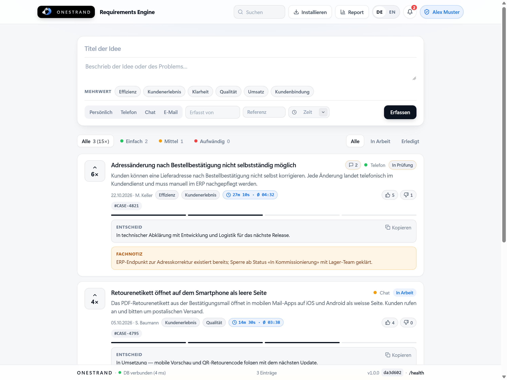
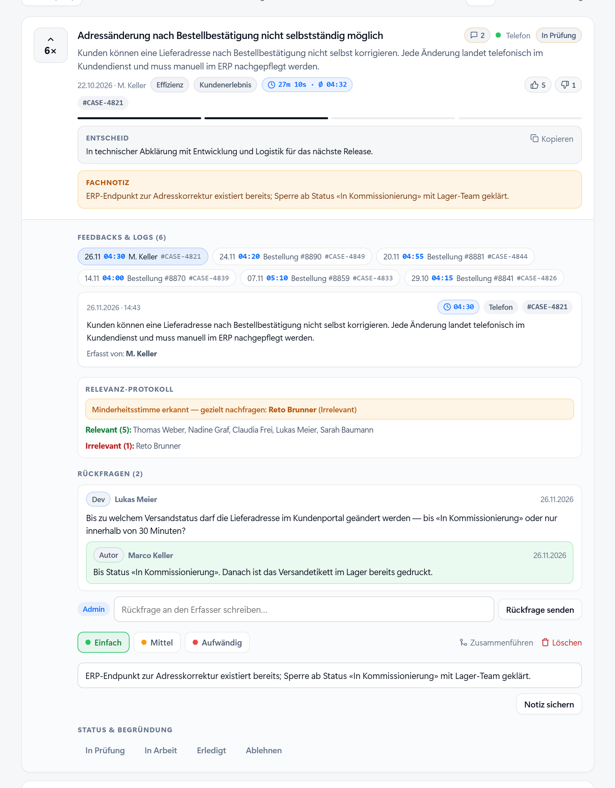
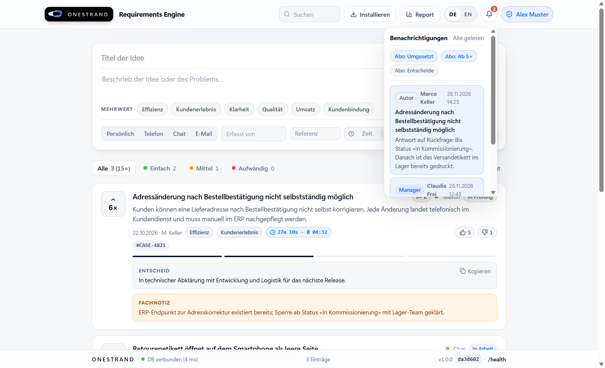
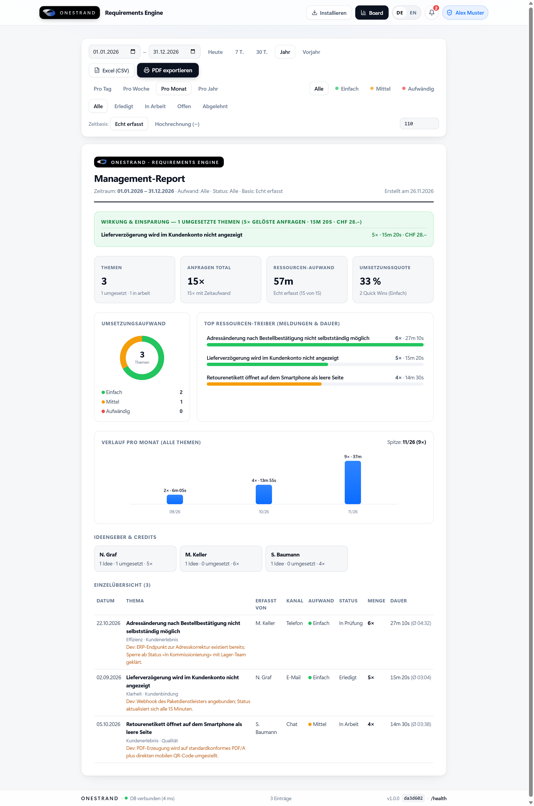
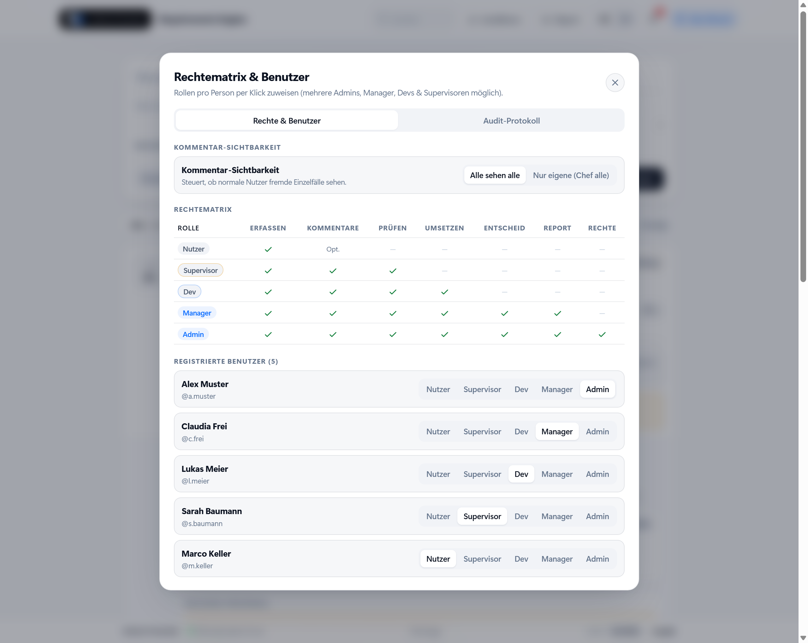

# ONESTRAND · Requirements Engine

> **Live-Produktivsystem:** `https://re.onestrand.ch` · **Container-Image (Multi-Arch):** `ghcr.io/baniox/requirements-engine:latest` (`linux/amd64` & `linux/arm64`)

Branchenneutrale, minimalistische interne Plattform für strukturiertes **Requirements Engineering**, **Mengen- und Zeitaufwand-Erfassung** sowie **Management-Reporting** — orientiert an **IREB (Pohl & Rupp)** und den Usability-Heuristiken von **Dr. Jakob Nielsen** (ohne Dropdown-Menüs, ohne unnötige Checkboxen, ohne Branchenballast).

Entwickelt und produktiv betrieben im Rahmen der **Anwendungs- und Transferleistung (ATL)** im Modul **M042 Applications Engineering** (HF Wirtschaftsinformatik, HKV Aarau).

---

## Einblick in die Oberfläche (Praxisbeispiel: Kundenservice & Logistik)

> Alle Beispielbilder zeigen ein vollständig fiktives, branchenneutrales Praxisbeispiel aus einem Schweizer Kundenservice- und Logistik-Betrieb (z. B. *Adressänderung nach Bestellbestätigung*, *mobiles Retourenetikett*, *Statusanzeige bei Lieferverzögerung*).

### 1. Hauptansicht — Strukturierte Erfassung & Prioritäten-Board
Mitarbeitende erfassen wiederkehrende Probleme in Sekunden mit **Titel**, **Beschrieb**, **Mehrwert-Badges** (*Effizienz, Kundenerlebnis, Klarheit, Qualität, Umsatz, Kundenbindung*), **Kanal**, **Referenz** und realem **Zeitaufwand (`Min:Sek`)**. Wiederkehrende Fälle werden mit `+1` samt eigener Gesprächsdauer gezählt und über `👍 / 👎` auf Relevanz bewertet.



### 2. Geöffneter Fall — Einzelfälle, Rückfragen-Thread & Minderheitsstimmen-Governance
Beim Aufklappen zeigt jeder Fall alle einzelnen Kundenmeldungen als kompakte Badges mit Vorschau, die **Aufwand-Einschätzung** (*Einfach / Mittel / Aufwändig*), rollengebundene Status-Aktionen sowie zwei smarte Qualitätsmechanismen:
- **Rückfragen-Thread mit Autoren-Sperre:** `Dev`, `Supervisor`, `Manager` und `Admin` stellen Rückfragen mit Rollen-Badge — ausschliesslich der ursprüngliche Fall-Erfasser kann direkt antworten.
- **Protokolliertes Relevanz-Voting (`👍 / 👎`):** Maximal 1 Stimme pro Person mit Name & Rolle gegen Missbrauch. Bei einer klaren Mehrheit (`≥ 3`) weist das System automatisch auf **Minderheitsstimmen** (1–2 abweichende Personen) hin, damit gezielt nachgefragt statt Spezialwissen überstimmt wird.



### 3. Smart-Benachrichtigungen & Report-Abos (Glocke)
Niemand muss das Board aktiv überwachen: Rückfragen, Antworten und selbst gewählte **1-Klick-Abos** (*Abo: Umgesetzt*, *Abo: Ab 5×*, *Abo: Entscheide*) informieren zielgerichtet über die Glocke oben rechts — schlank im Nebenlauf statt als zusätzliche Hauptarbeit.



### 4. Management-Report, Einsparungs-Nachweis & Excel-/PDF-Export
Der Report wertet beliebige Zeiträume nach **Tag, Woche, Monat oder Jahr** aus und rechnet standardmässig **ausschliesslich mit real erfassten Zeiten** (keine geschätzten Fantasiezahlen). Umgesetzte Themen zeigen mit optionalem Stundensatz (`CHF Std.`) die messbare Entlastung. **Menge** und **Dauer** sind in Report und Excel-CSV sauber getrennt filter- und summierbar.



### 5. 5-Rollen-Rechtematrix, Kommentar-Sichtbarkeit & Audit-Protokoll
Administratoren verwalten beliebig viele **Nutzer, Supervisoren, Devs, Manager und Admins** per 1 Klick (Änderungen greifen live ohne Neu-Login), steuern die **Kommentar-Sichtbarkeit** (*Alle sehen alle* vs. *Nur eigene, Chef alle*) und prüfen das vollständige **Audit-Protokoll**.



---

## Kernfunktionen auf einen Blick

| Bereich | Umsetzung |
| :--- | :--- |
| **Erfassung & Quantifizierung** | Titel, Beschrieb, 6 Einwort-Mehrwert-Badges, 4 Eingangskanäle (*Persönlich, Telefon, Chat, E-Mail*), Erfasser, Referenz-ID und individueller Zeitaufwand (`Min:Sek`, Minimum `01:00` bei `+1`-Buchung). |
| **5-Rollen-Workflow (RBAC)** | `Nutzer` (erfassen/voten) · `Supervisor` (`In Prüfung`) · `Dev` (`In Arbeit` & `Erledigt`) · `Manager` (`Ablehnen`, `Löschen`, Report & Excel) · `Admin` (Rechtematrix, Sichtbarkeit, Audit-Log). |
| **Rückfragen & Abos** | Rollen-gekennzeichneter Q&A-Thread mit serverseitiger Autoren-Antwortsperre (`HTTP 403` für Dritte) + In-App-Glocke mit persönlichen Event-Abos (*Umgesetzt*, *Ab 5×*, *Entscheide*). |
| **Relevanz-Governance** | Protokolliertes `👍 / 👎`-Voting (1 Stimme pro Person) mit automatischer **Minderheitsstimmen-Erkennung** zur Wertschätzung von Fachwissen und als Missbrauchsschutz. |
| **Management-Report & Exporte** | Saisonale Auswertung (Tag/Woche/Monat/Jahr), reale Messzeiten, ROI-Einsparungsbox (`CHF Std.`), druckfertiges A4-PDF ohne Browser-Kopfzeile, UTF-8 Excel-CSV mit getrennten Spalten *Menge* & *Dauer*. |
| **Zweisprachigkeit & Omnichannel** | Vollständig zweisprachig (**DE \| EN**), nutzbar im Browser, als installierbare **Desktop-/Mobile-PWA** (`site.webmanifest`) sowie einbettbar in **Confluence** (`?embed=1` + Forge-Manifest). |
| **Betrieb, Sicherheit & Auto-Deploy** | Aktiver `/health`-Check (`SELECT 1`), Non-Root-Container (`Node 24 Alpine`), `scrypt`-Passwort-Hashing + persistentes `session_secret` in PostgreSQL, Gitleaks Secret-Scan, **25 automatisierte Tests**, automatisches **Watchtower-Deployment** alle 30 Sekunden ab `main`. |

---

## Architektur & Automatisches Deployment (CI/CD + Watchtower)

Jede Änderung folgt einem vollständig automatisierten, nachvollziehbaren Ablauf:

1. **Entwicklung auf Feature-Branch & Pull Request:** GitHub Actions startet automatisch alle **25 Unit- & API-Tests (`npm test`)** sowie einen vollständigen **Gitleaks Secret-Scan** über die gesamte Git-History.
2. **Merge auf `main`:** Nach erfolgreichem Test- und Security-Gate baut GitHub Actions automatisch ein **Multi-Arch-Container-Image** (`linux/amd64` + `linux/arm64`) inkl. Git-Commit-Hash und veröffentlicht es auf `ghcr.io/baniox/requirements-engine:latest`.
3. **Auto-Deploy via Watchtower (30 s):** Auf dem Ziel-Host (Oracle Cloud Produktivserver für `https://re.onestrand.ch` sowie lokal per `docker compose up -d`) prüft `nickfedor/watchtower` alle 30 Sekunden per Label-Scope (`WATCHTOWER_SCOPE=requirements-engine`) das Image auf `ghcr.io` und startet ausschliesslich den `app`-Container ohne Handarbeit und ohne Datenverlust neu.

---

## Schnellstart (Betrieb / Drittperson mit fertigem GHCR-Image)

Das fertige Multi-Arch-Image (`linux/amd64` & `linux/arm64`) liegt öffentlich unter `ghcr.io/baniox/requirements-engine` und startet ohne Anpassungen auf Windows (x64 & ARM64), macOS und Linux:

1. Beispielkonfiguration kopieren und eigenes lokales Datenbank-Passwort setzen:
   ```powershell
   Copy-Item .env.example .env
   ```
2. Container-Stack starten (**PostgreSQL 17 + App + Cloudflare Tunnel + Watchtower**):
   ```powershell
   docker compose up -d
   ```
   *(Für eine fest gepinnte Release-Version `APP_IMAGE_TAG=v1.0.0` in `.env` setzen.)*
3. Healthcheck & öffentliche HTTPS-URL prüfen:
   ```powershell
   curl http://localhost:3000/health
   docker compose logs tunnel
   ```

> **Erster Login:** Das erste registrierte Benutzerkonto erhält automatisch die Rolle **Admin** — es liegen keinerlei hartcodierte Passwörter oder Secrets im Repository.

---

## Lokale Entwicklung & Tests

```powershell
# Lokales Image bauen und starten
docker compose -f docker-compose.yml -f docker-compose.dev.yml up -d --build

# Alle 25 automatisierten Tests ausführen
npm test
```

## Weiterführende Dokumentation

- [Architektur & Zielbild](docs/ARCHITEKTUR.md)
- [Agile Sprint-Planung](docs/SPRINT_PLANUNG.md)
- [Testkonzept & Testprotokoll](docs/TESTKONZEPT_UND_PROTOKOLL.md)
- [Betriebs-Checkliste (6 Bereiche, 24 Punkte)](docs/BETRIEBS_CHECKLISTE.md)
- [KI-Arbeitsprotokoll](docs/KI_ARBEITSPROTOKOLL.md)
- [Confluence-Integration (`?embed=1` & Forge)](integrations/confluence/README.md)

---

## Lizenz

**Proprietär — Alle Rechte vorbehalten.**

Copyright © 2026 Onestrand | Alban Hyseni. Alle Rechte vorbehalten.

Siehe [LICENSE](LICENSE). Keine Nutzung, Vervielfältigung, Veränderung oder Weitergabe ohne vorgängige schriftliche Zustimmung.
