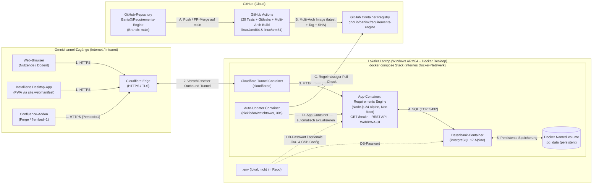

# Zielbild und Architektur (Teilaufgabe 1 — 5 Punkte)

> **Status:** Abgeglichen 1:1 mit dem laufenden Produktivsystem (**ONESTRAND · Requirements Engine**).

## 1. Architekturdiagramm (Mermaid)

## 2. Kurzbeschreibung (für ½ bis max. 1 A4-Seite im Bericht)

### Zielbild
Mit **ONESTRAND · Requirements Engine** wird eine branchenneutrale, interne Webapplikation für systematisches Requirements Engineering (nach **IREB** und **Dr. Jakob Nielsen** — ohne Dropdowns, ohne unnötige Checkboxen, ohne vorausgefüllte Branchenannahmen) vollständig reproduzierbar und automatisiert betrieben. Interne Teams erfassen wiederkehrende Kunden- und Betriebsrückmeldungen (über die Kanäle *Persönlich, Telefon, Chat, E-Mail* inkl. optionaler *CRM-/Ref-ID*), quantifizieren deren Häufigkeit samt realem individuellem Zeitaufwand (`Min:Sek`), werten saisonale Verläufe (Tag / Woche / Monat / Jahr) im Management-PDF-Report aus und übergeben geprüfte Anforderungen bei Bedarf als *Jira Story* oder *Feature*. Durch den Omnichannel-Aufbau läuft dieselbe Applikation im Web, als installierbare Desktop-App (PWA) sowie als einbettbares Confluence-Addon — betrieben lokal auf dem Entwickler-Laptop in isolierten Docker-Containern und ohne offene Router-Ports sicher über HTTPS erreichbar.

### Komponenten auf dem Laptop
Die gesamte Laufzeitumgebung ist deklarativ in `docker-compose.yml` definiert:
- **App-Container (`app`):** Führt die Node.js-24-Applikation als Non-Root-Benutzer (`node`) aus, stellt Web-/PWA-UI, die lokale Requirements-Engine (ohne bezahlte KI-APIs), Management-Report, Jira-/CSV-/Markdown-Exporte sowie den aktiven `/health`-Endpunkt bereit.
- **Datenbank-Container (`db`):** Betreibt PostgreSQL 17 getrennt von der Applikation im internen Docker-Netzwerk.
- **Persistentes Volume (`pg_data`):** Speichert Anforderungen, Zeitstempel-Meldungen (`story_mentions`), erfasste Zeitaufwände, Ref-IDs und Entscheid-Logs ausserhalb des Container-Dateisystems über Neustarts hinweg.
- **Cloudflare Tunnel (`tunnel`):** Stellt eine verschlüsselte ausgehende Verbindung zur Cloudflare-Edge her (Quick Tunnel `trycloudflare.com`, keine Firewall-Freigaben nötig).
- **Auto-Updater (`watchtower`):** Überwacht über das Label `com.centurylinklabs.watchtower.enable=true` ausschliesslich das eigene App-Image auf `ghcr.io` und aktualisiert den Container vollautomatisch.
- **Lokale `.env`-Datei:** Liefert Zugangsdaten zur Laufzeit, ist per `.gitignore` ausgeschlossen und gelangt nie in Git.

### Weg einer Anfrage (Request-Flow)
1. Eine nutzende Person öffnet die öffentliche HTTPS-Adresse im Browser, in der installierten PWA-Desktop-App oder eingebettet in Confluence (`?embed=1`).
2. Die Cloudflare-Edge terminiert TLS und leitet die Anfrage durch den verschlüsselten Tunnel an den lokalen `cloudflared`-Container.
3. `cloudflared` reicht den Request im internen Docker-Netzwerk an `app:3000` weiter.
4. Die App prüft Eingaben, liest oder schreibt strukturierte Daten in PostgreSQL (`db:5432`) und liefert die Antwort über denselben Weg zurück.

### Weg einer Änderung (Deployment-Flow)
1. Änderungen entstehen auf Feature-Branches und werden erst nach grünen automatisierten Tests per Pull Request in `main` gemergt.
2. Der Push auf `main` startet GitHub Actions: 20 automatisierte Tests (`npm test`), ein vollständiger Secret-Scan über die gesamte Git-History (`gitleaks`) und der Multi-Arch-Docker-Build (`linux/amd64` + `linux/arm64`) nach `ghcr.io`.
3. Watchtower erkennt auf dem Laptop das neue Image per Pull-Verfahren und startet nur den `app`-Container neu — ohne Handarbeit und ohne Datenverlust.
4. Der neue Git-Commit-Hash ist sofort im Footer und unter `/health` nachweisbar.
