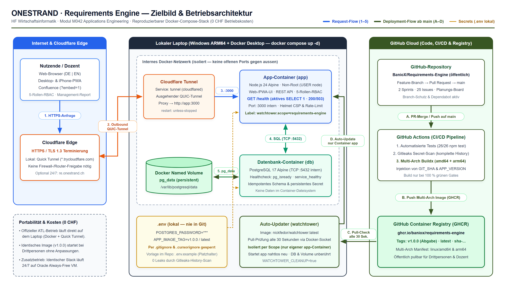
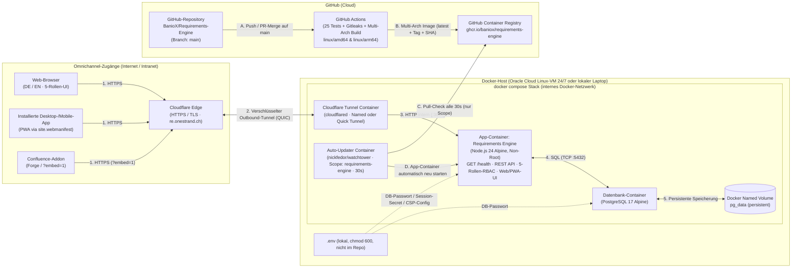

# Zielbild und Architektur (Teilaufgabe 1 — 5 Punkte)

> **Status:** Abgeglichen 1:1 mit dem laufenden System (**ONESTRAND · Requirements Engine** — offizieller ATL-Betrieb lokal auf dem Laptop via `docker compose up -d` + Cloudflare Quick Tunnel, 0 CHF; identischer Stack läuft zusätzlich optional 24/7 auf Oracle Cloud Always Free unter `https://re.onestrand.ch`).

## 1. Architekturdiagramm (`draw.io` Reinzeichnung + Mermaid-Quelle)

- **Editierbare `draw.io`-Datei:** [docs/architektur.drawio](architektur.drawio)
- **Exportierte Grafik (Bericht):**

## 2. Kurzbeschreibung (für ½ bis max. 1 A4-Seite im Bericht)

### Zielbild
Mit **ONESTRAND · Requirements Engine** wird eine branchenneutrale, zweisprachige (`DE | EN`) interne Webapplikation für systematisches Requirements Engineering (nach **IREB** und **Dr. Jakob Nielsen** — ohne Dropdowns, ohne unnötige Checkboxen, ohne Branchenballast) vollständig reproduzierbar und automatisiert betrieben. Interne Teams erfassen wiederkehrende Kunden- und Betriebsrückmeldungen mit **Titel**, **Beschrieb**, **Mehrwert-Badges**, Eingangskanal (*Persönlich, Telefon, Chat, E-Mail*), **Referenz** und realem **Zeitaufwand (`Min:Sek`)**, klären offene Punkte im **Rückfragen-Thread** (mit Autoren-Antwortsperre und Smart-Abos), prüfen Relevanz über **protokolliertes Voting (`👍 / 👎`) inkl. Minderheitsstimmen-Hinweis** und steuern den Bearbeitungsfluss über eine **5-Rollen-Rechtematrix** (*Nutzer, Supervisor, Dev, Manager, Admin*). Der **Management-Report** weist reale Stunden, Saisonalität (Tag/Woche/Monat/Jahr) und Einsparungen als A4-PDF und Excel-CSV (getrennte Spalten *Menge* und *Dauer*) aus.

Durch das identische `docker-compose.yml`-Setup läuft das System ohne Code-Anpassung sowohl **24/7 produktiv auf einer Linux-VM (`https://re.onestrand.ch` via Named Cloudflare Tunnel)** als auch **lokal auf dem Laptop oder bei einer Drittperson** (`docker compose up -d` mit Quick Tunnel, ohne offene Router-Ports).

### Komponenten im Container-Stack
Die gesamte Laufzeitumgebung ist deklarativ in `docker-compose.yml` definiert:
- **App-Container (`app`):** Führt die Node.js-24-Applikation als Non-Root-Benutzer (`node`) aus, stellt Web-/PWA-UI, 5-Rollen-RBAC (`scrypt` + persistentes `session_secret` in PostgreSQL `app_meta`), Rückfragen, Smart-Benachrichtigungen, Relevanz-Governance, Management-Report (PDF/Excel-CSV) sowie den aktiven `/health`-Endpunkt bereit.
- **Datenbank-Container (`db`):** Betreibt PostgreSQL 17 getrennt von der Applikation im internen Docker-Netzwerk.
- **Persistentes Volume (`pg_data`):** Speichert Benutzer, Ideen, Zeitstempel-Einzelfälle (`story_mentions`), Rückfragen (`story_questions`), Relevanz-Stimmen (`story_relevance_votes`), Benachrichtigungen/Abos und das Audit-Log (`decision_log`) dauerhaft über Neustarts und Updates hinweg.
- **Cloudflare Tunnel (`tunnel`):** Baut eine verschlüsselte ausgehende QUIC-Verbindung zur Cloudflare-Edge auf (Produktiv: Named Tunnel für `re.onestrand.ch`; lokal/Drittperson: Quick Tunnel `trycloudflare.com` — keine offenen Firewall- oder Router-Ports nötig).
- **Auto-Updater (`watchtower`):** Überwacht über `WATCHTOWER_LABEL_ENABLE=true` und `WATCHTOWER_SCOPE=requirements-engine` ausschliesslich den eigenen App-Container auf `ghcr.io` und aktualisiert ihn alle 30 Sekunden vollautomatisch, ohne andere Container auf demselben Host zu berühren.
- **Lokale `.env`-Datei:** Liefert Datenbank-Passwort und optionale Konfiguration zur Laufzeit, ist per `.gitignore` ausgeschlossen und gelangt nie in Git.

### Weg einer Anfrage (Request-Flow)
1. Eine nutzende Person öffnet `https://re.onestrand.ch` (oder lokal die Quick-Tunnel-HTTPS-URL) im Browser, als installierte PWA-Desktop-App oder eingebettet in Confluence (`?embed=1`).
2. Die Cloudflare-Edge terminiert TLS und leitet die Anfrage durch den verschlüsselten Outbound-Tunnel an den `cloudflared`-Container.
3. `cloudflared` reicht den Request im internen Docker-Netzwerk an `app:3000` weiter (`trust proxy` aktiv).
4. Die App prüft Eingaben und Session/Rolle live gegen PostgreSQL (`db:5432`), führt die gewünschte Aktion aus und liefert die Antwort verschlüsselt zurück.

### Weg einer Änderung (Deployment-Flow)
1. Änderungen entstehen auf Feature-Branches und werden erst nach grünen Checks per Pull Request in `main` gemergt.
2. Der Push auf `main` startet GitHub Actions: **25 automatisierte Tests (`npm test`)**, ein vollständiger **Secret-Scan über die gesamte Git-History (`gitleaks`)** und der **Multi-Arch-Docker-Build** (`linux/amd64` + `linux/arm64`) nach `ghcr.io`.
3. Watchtower erkennt auf dem Ziel-Host innerhalb von 30 Sekunden das neue Image per Pull-Verfahren und startet ausschliesslich den `app`-Container neu — ohne Handarbeit, ohne Session-Verlust und ohne Datenverlust.
4. Der neue Git-Commit-Hash ist unmittelbar im Footer und unter `/health` nachweisbar.
