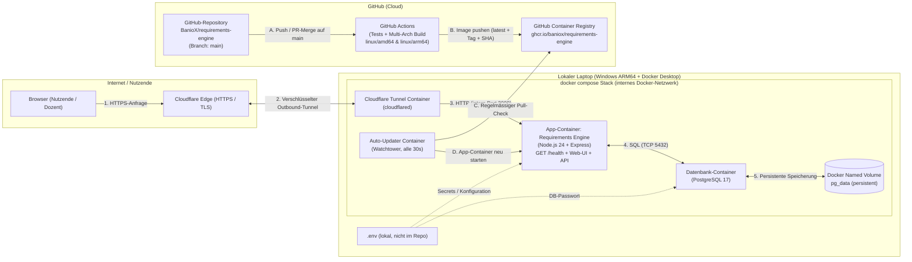

# Zielbild und Architektur (Entwurf für Teilaufgabe 1)

> **Status:** Entwurf zur Prüfung und Freigabe durch den Betreiber (Alban Hyseni).
> Nach der finalen Umsetzung wird dieses Diagramm 1:1 mit der laufenden Lösung abgeglichen und in `draw.io` für den PDF-Bericht reingezeichnet.

## 1. Architekturdiagramm (Mermaid-Entwurf)

## 2. Kurzbeschreibung (Entwurf für ½ bis max. 1 A4-Seite im Bericht)

### Zielbild
Mit **Requirements Engine** wird eine branchenneutrale Webapplikation für KMU (mit praxisnahen Beispielprozessen, u. a. aus dem eBanking-/Mobile-Banking-Alltag) vollständig reproduzierbar und automatisiert betrieben. Die Applikation läuft lokal auf dem Entwickler-Laptop in isolierten Docker-Containern und wird ohne Port-Weiterleitung im Heim- oder Schulnetz sicher über HTTPS veröffentlicht.

### Komponenten auf dem Laptop
Die gesamte Laufzeitumgebung wird deklarativ über `docker-compose.yml` gesteuert:
- **App-Container (`app`):** Führt die Node.js-Webapplikation aus, stellt das Web-UI, die lokale Requirements-Engine sowie den aktiven `/health`-Endpunkt bereit.
- **Datenbank-Container (`db`):** Betreibt PostgreSQL 17 getrennt von der Applikationslogik in einem internen Docker-Netzwerk.
- **Persistentes Volume (`pg_data`):** Speichert alle Datenbankinhalte ausserhalb des Container-Dateisystems, sodass Prozesse, Klick-Schritte, User Stories und Entscheide einen Container-Neustart unbeschadet überstehen.
- **Cloudflare Tunnel (`tunnel`):** Baut eine verschlüsselte ausgehende Verbindung zur Cloudflare-Edge auf. Eingehende Firewall-Freigaben auf dem Laptop sind nicht erforderlich.
- **Auto-Updater (`watchtower`):** Überwacht das App-Image in der GitHub Container Registry und aktualisiert den laufenden App-Container automatisch.
- **Lokale `.env`-Datei:** Liefert Zugangsdaten zur Laufzeit, ist per `.gitignore` ausgeschlossen und gelangt nie ins Git-Repository.

### Weg einer Anfrage (Request-Flow)
1. Eine nutzende Person ruft die öffentliche HTTPS-Adresse im Browser auf.
2. Die Cloudflare-Edge terminiert TLS und leitet die Anfrage durch den verschlüsselten Tunnel an den lokalen `cloudflared`-Container weiter.
3. `cloudflared` reicht den Request im internen Docker-Netzwerk an den App-Container (`app:3000`) weiter.
4. Die App verarbeitet die Anfrage, liest oder schreibt strukturierte Daten im PostgreSQL-Container (`db:5432`) und liefert das Ergebnis über denselben Weg zurück.

### Weg einer Änderung (Deployment-Flow)
1. Änderungen werden auf einem Feature-Branch entwickelt und per Pull Request nach grünen Tests in `main` gemergt.
2. Der Push auf `main` startet automatisch eine GitHub-Actions-Pipeline: Sie führt die automatisierten Tests aus, baut ein Multi-Arch-Docker-Image (`linux/amd64` und `linux/arm64`) und veröffentlicht es inkl. Git-Commit-Hash als Version auf `ghcr.io`.
3. Da GitHub den lokalen Laptop von aussen nicht direkt ansprechen kann, zieht der lokal laufende Watchtower-Container das neue Image per Pull-Verfahren von `ghcr.io` und ersetzt den App-Container ohne Handarbeit.
4. Über den sichtbaren Commit-Hash im Web-UI und im `/health`-Endpunkt lässt sich die neue Version sofort verifizieren.
